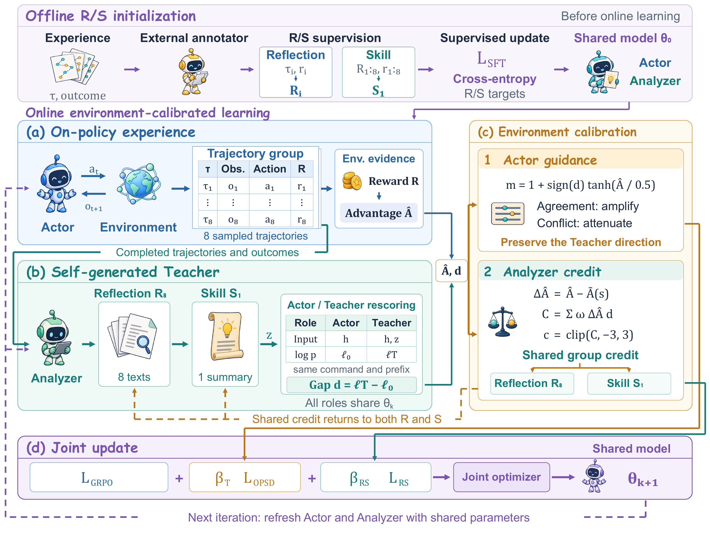
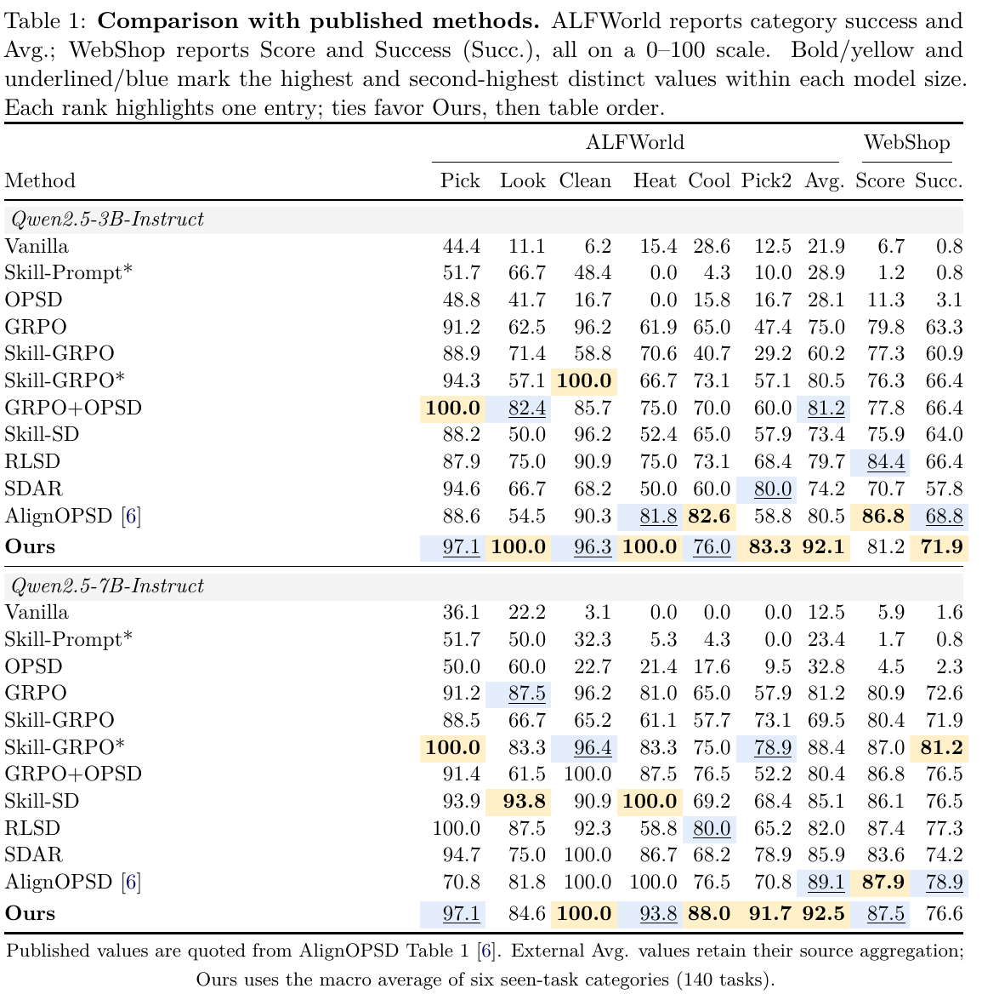
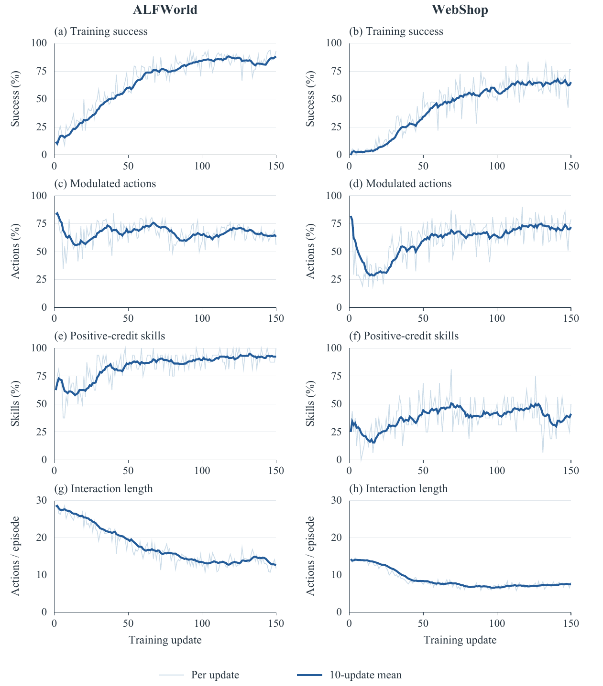

# ECOS: Environment-Calibrated On-Policy Self-Distillation for Language Agents

SFT materials and training pipelines for **Qwen2.5-3B / 7B on ALFWorld and WebShop**.

[Overview](#overview) · [Main results](#main-results) · [Installation](#installation) · [Training](#training) · [Evaluation](#evaluation) · [中文运行指南](README_zh.md)

## Overview

Environment-calibrated self-distillation trains a shared model to act in an environment and analyze its experience. The Actor collects trajectory groups; the Analyzer produces a Reflection for each trajectory and consolidates a Skill. Conditioning the pre-update policy on that Skill forms a self-Teacher. Environmental command advantages calibrate its guidance and provide credit for the Reflections and Skills that generated it.

The pipeline has two stages:

1. **Reflection / Skill SFT.** Initialize analysis generation using the included task-specific R8+S1 materials.
2. **Online self-distillation with joint R/S learning.** Collect eight natural trajectories per task, generate analysis with the policy, rescore sampled actions with the self-Teacher, and update the shared model with GRPO, calibrated Teacher guidance and R/S credit.

At inference, only the trained Actor is used. Skill generation and Teacher scoring are training components.



*Figure 2 from the manuscript supplied on 10 November 2026.*

### Released method settings

All four profiles share the following settings:

| Component | Setting |
|---|---|
| Teacher scope | Command-content tokens inside `<action>...</action>` |
| Teacher coefficient | **0.01** |
| Group mask | **q = 1 in both environments**; all-success groups retain Teacher supervision |
| Modulation | One multiplier from the command's mean gap and same-turn environmental advantage; each token keeps its own gap |
| Reflection / Skill coefficient | **0.1**, accumulated after the main backward pass into the same Adam update |
| Main GRPO / KL / entropy | Full valid response; KL 0.01, entropy 0.001 |

For command content $\mathcal C$, the detached gaps and calibrated weights are

$$
\delta_\ell=\log\pi_T(y_\ell)-\log\pi_{\mathrm{old}}(y_\ell),\quad
d=\sum_{\ell\in\mathcal C}\delta_\ell,\quad \bar d=d/|\mathcal C|,
\qquad w_\ell=\mathbf 1[\ell\in\mathcal C]\delta_\ell
\left[1+\operatorname{sign}(\bar d)\tanh\left(\frac{\hat A_{\mathrm{command}}}{0.5}\right)\right].
$$

The command-content tokens share the multiplier, while their individual gaps and signs are preserved. Empty command spans have zero mean gap and no eligible tokens. Reasoning, standalone tags and whitespace-only tokens receive no direct Teacher signal. Teacher loss retains the complete valid-response denominator and signed PPO clipping. The author clarified that the group mask is one in both environments; `skip_teacher_on_all_success=false` implements this choice.

R/S credit uses the **raw summed command gap** with trajectory-equal transition weights and within-state centered advantages (Equations 16–20). The resulting group credit is clipped to ±3 and assigned to all eight Reflections and the Skill. Reflection and Skill losses each receive half the Analyzer weight and share the Actor's optimizer update, with no extra optimizer steps. See [the method and runtime guide](README_zh.md#方法).

## Main results

The table and curves below are copied from the **ECOS manuscript supplied on 10 November 2026**. Ours reports three evaluation seeds per trained checkpoint; these are paper results, not new measurements from this code update. Protocols and machine-readable tables are in [docs/results.md](docs/results.md).



ALFWorld reports the macro average over six seen-task categories (140 tasks). WebShop draws 128 goals without replacement per evaluation seed and reports environment Score and exact Success. Methods with the same seed share the panel. External comparison values retain their source aggregation.



*Appendix Figure D.1: training success, modulated-action coverage, positive-credit skills and interaction length; dark lines are trailing 10-update means.*

## Installation

Training requires **Linux, Python 3.11, CUDA and 2–8 GPUs**. The included launcher manages a private Ray runtime and checkpoint archive for one host. FSDP multi-node resource pools remain available in the underlying framework.

```bash
python -m venv .venv
source .venv/bin/activate
bash scripts/setup.sh
python scripts/download_model.py --size 3b --output models/Qwen2.5-3B-Instruct
python scripts/download_model.py --size 7b --output models/Qwen2.5-7B-Instruct
```

The runtime recipe pins Torch 2.8, vLLM 0.11 and Transformers 4.57.3. Model weights and original environment assets are obtained separately. Full FP32 Model/Adam checkpoints require substantial host RAM and disk; see [resource guidance](README_zh.md#安装与环境).

### Environments

```bash
# ALFWorld
export ALFWORLD_DATA="$PWD/assets/alfworld"
alfworld-download

# WebShop: install Java 11 and set JAVA_HOME first
python scripts/prepare_webshop.py --asset-root assets/webshop --download
export WEBSHOP_ASSET_ROOT="$PWD/assets/webshop"
```

WebShop also needs the spaCy English model installed by `scripts/setup.sh`. See [docs/environments.md](docs/environments.md) for directory layouts and existing-asset reuse. Only text ALFWorld and WebShop simulators are included.

## Training

### Included SFT materials

| Profile | Backbone | Materials | RL configuration |
|---|---|---|---|
| `alfworld_3b` | Qwen2.5-3B-Instruct | [ALFWorld 3B](data/sft/alfworld_3b) | [YAML](configs/alfworld_3b.yaml) |
| `alfworld_7b` | Qwen2.5-7B-Instruct | [ALFWorld 7B](data/sft/alfworld_7b) | [YAML](configs/alfworld_7b.yaml) |
| `webshop_3b` | Qwen2.5-3B-Instruct | [WebShop 3B](data/sft/webshop_3b) | [YAML](configs/webshop_3b.yaml) |
| `webshop_7b` | Qwen2.5-7B-Instruct | [WebShop 7B](data/sft/webshop_7b) | [YAML](configs/webshop_7b.yaml) |

Each set contains **200 task groups, 1,600 Reflections, 200 Skills and 1,600 natural trajectories**. Together they provide 7,200 SFT texts and 6,400 trajectories, with annotation messages and original token IDs. See [data/README.md](data/README.md).

All offline annotations use **GPT-6.1 sol, maximum reasoning effort**, as confirmed by the author. Historical model labels remain recorded in the material metadata. Both model sizes start SFT from the original Qwen2.5-Instruct backbone; WebShop trajectories are collected from the corresponding GRPO40 policy.

### Stage 1: Reflection / Skill SFT

```bash
python scripts/train_sft.py \
  --config alfworld_3b --model models/Qwen2.5-3B-Instruct \
  --gpus 0,1,2,3,4,5,6,7 --output runs/sft_alfworld_3b
```

Choose any profile from the table and its corresponding model. SFT uses full-parameter AdamW, LR 5e-6 and 3 epochs / 600 updates. Each update uses one task's eight Reflections and one Skill:

$$\mathcal L_{\mathrm{SFT}}=0.5\,\operatorname{mean}_{j=1}^{8}\operatorname{NLL}(R_j)+0.5\,\operatorname{NLL}(S).$$

NLL supervises complete target texts at response positions. The sequence limit is 32,768; overlength samples raise an error. Each epoch saves an HF model and full training state. `checkpoint600` supplies the RL initialization.

### Stage 2: Environment-calibrated RL

```bash
python scripts/train_rl.py \
  --config alfworld_3b --model runs/sft_alfworld_3b/checkpoint600 \
  --gpus 0,1,2,3,4,5,6,7 --alfworld-data "$ALFWORLD_DATA" \
  --run-dir runs/rl_alfworld_3b
```

For WebShop, select `webshop_3b` or `webshop_7b` and replace `--alfworld-data` with `--webshop-assets "$WEBSHOP_ASSET_ROOT"`. The 7B profiles use their corresponding 7B SFT checkpoint.

Shared defaults: **150 updates, 16 groups × G8, logical world 8, LR 1e-6, warmup 0, clip 0.2, KL 0.01, entropy 0.001**. Every update saves complete training state; fixed 128-task validation runs every five updates and at the end.

| Setting | ALFWorld | WebShop |
|---|---:|---:|
| PPO mini-batch / micro-batch per GPU | 256 / 32 | 64 / 8 |
| Maximum actions / history | 30 / 5 | 15 / 2 |
| Actor prompt / response tokens | 2048 / 512 | 4096 / 512 |
| Reflection / Teacher prompt tokens | 8096 / 4096 | 16384 / 6144 |

The micro-batches are implementation choices compatible with the mini-batches; Table B.2 does not prescribe them. The native context remains 32,768 tokens. Overlength R/S input handling and complete-state saving are retained.

### Complete SFT → RL pipeline

```bash
python scripts/pipeline.py \
  --config webshop_7b --base-model models/Qwen2.5-7B-Instruct \
  --gpus 0,1,2,3,4,5,6,7 --webshop-assets "$WEBSHOP_ASSET_ROOT" \
  --run-dir runs/webshop_7b
```

`--stage sft` or `--stage rl` selects a stage; `--dry-run` renders commands without starting training. For an interrupted RL run, inspect `--status` and append `--resume` to the original command. Recovery uses the latest complete full-state checkpoint. See [the runtime guide](README_zh.md#保存和运行材料) for checkpoint contents, durable readback and process ownership.

## Evaluation

Export a native Actor checkpoint, then evaluate the frozen policy:

```bash
python scripts/export_model.py \
  --checkpoint runs/rl_alfworld_3b/checkpoints/global_step_150 \
  --output models/alfworld_3b_rl150
python scripts/evaluate_alfworld.py \
  --model models/alfworld_3b_rl150 --alfworld-data "$ALFWORLD_DATA" \
  --gpu 0 --seeds 0,1,2 --output runs/eval_alfworld_3b

python scripts/export_model.py \
  --checkpoint runs/rl_webshop_3b/checkpoints/global_step_150 \
  --output models/webshop_3b_rl150
python scripts/evaluate_webshop.py \
  --model models/webshop_3b_rl150 --asset-root "$WEBSHOP_ASSET_ROOT" \
  --gpu 0 --seeds 0,1,2 --output runs/eval_webshop_3b
```

Both evaluators use T0.4 / top-p1 / top-k−1 / n1 and default to evaluation seeds 0,1,2. ALFWorld evaluates Seen140 + Unseen134 and reports per-category rates, six-category macro success, and micro success for reference. WebShop samples 128 of goals 0–499 with `random.Random(seed).sample`, fixes catalogue seed0, and reports Success (%) plus Score (mean normalized final environment score ×100). Per-seed goal IDs and trajectories are saved. Cross-seed variability uses the sample standard deviation. The documented sampler is reproducible; it does not assert recovery of unpublished historical panel IDs.

## Repository guide

```text
configs/          Four profiles and shared method settings
data/sft/         R8+S1 annotations, token IDs and natural trajectories
data/rl/          Environment task metadata
scripts/          Setup, SFT, RL, pipeline, export and evaluation
response_rs/      Portable SFT, configuration and evaluation utilities
agent_system/     ALFWorld/WebShop text interaction, history and rewards
verl/             Required FSDP, synchronous vLLM and joint-update framework
docs/             Environment guide, paper figures/results and validation
tests/            Objective, gradient, resume, storage and packaging checks
```

Native-save modules retain complete Model/Adam/extra, scheduler, RNG, DataLoader and environment recovery, including byte readback/fsync, incomplete-save retention and precise retirement of this run's processes.

The retained implementation and removed inactive experiment paths are listed in [docs/source_scope.md](docs/source_scope.md).

## Validation

```bash
python -m pytest tests -q
python scripts/inspect_material.py
```

Local checks exercise the actual Actor/R/S losses, per-token Teacher gaps, command-derived modulation, disabled all-success masking, joint gradients, seeded evaluation panels, metrics and storage/resume utilities. GPU training and full environment evaluations were not rerun during this update. This release supplies the four full-method profiles; ablation and local-GRPO launch recipes are outside this update. See [docs/validation.md](docs/validation.md).

## Acknowledgements and licenses

This implementation builds on [GRSD](https://github.com/BinbZheng1/GRSD), [veRL](https://github.com/volcengine/verl), [verl-agent / GiGPO](https://github.com/langfengQ/verl-agent), [ALFWorld](https://github.com/alfworld/alfworld) and [WebShop](https://github.com/princeton-nlp/WebShop). Source notices and environment licenses are retained; see [THIRD_PARTY.md](THIRD_PARTY.md) and [LICENSE](LICENSE).
